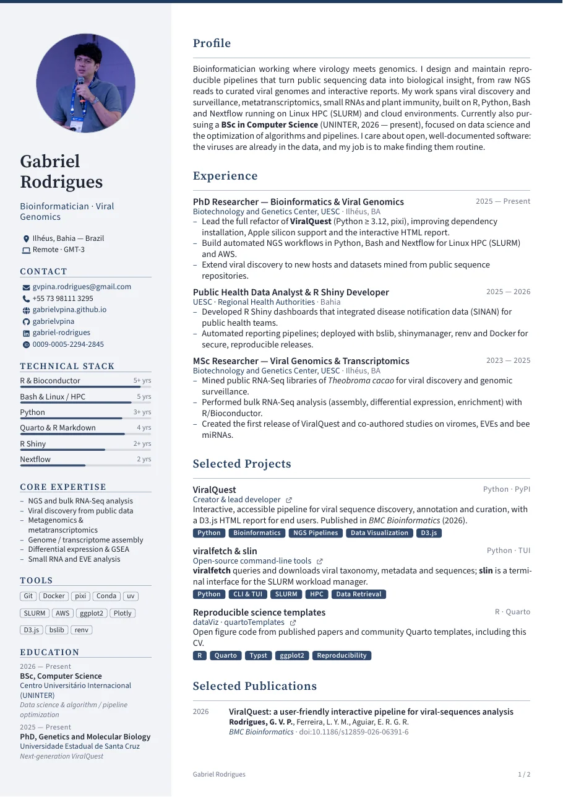
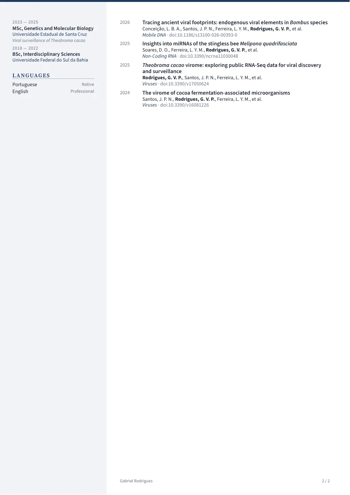
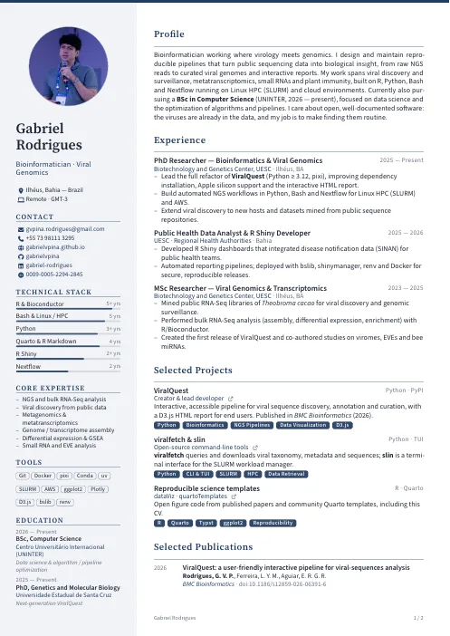
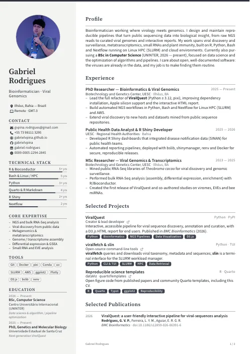
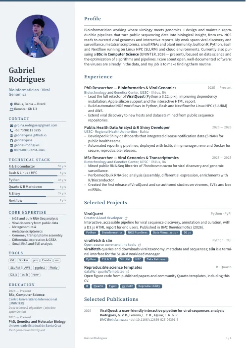
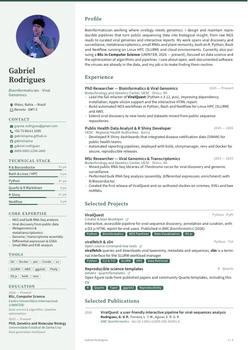
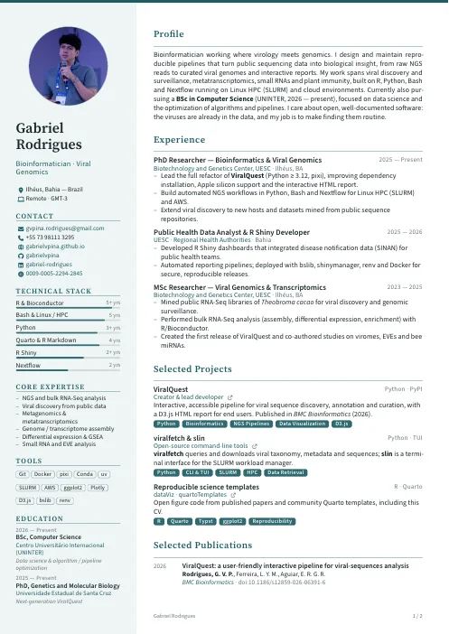
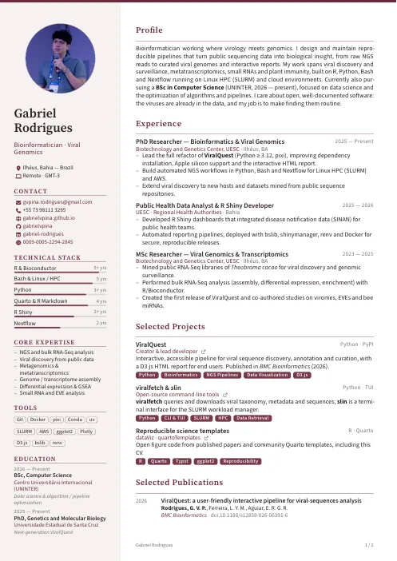
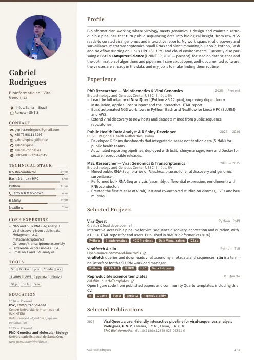
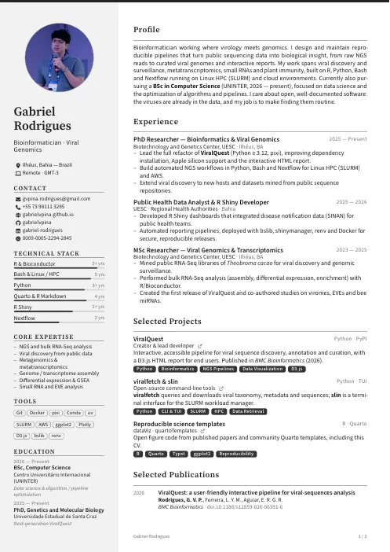

# formal-cv · a sober Quarto CV template

A clean, two-column CV for [Quarto](https://quarto.org), compiled to PDF by
[Typst](https://typst.app). You fill in a single `.qmd` file in plain YAML and
Markdown, run one command, and get a print-ready A4 PDF.

<p align="center">
  
  
</p>

**Features**

- **Plain syntax:** the sidebar is YAML and the main column is Markdown. You don't need R, Python or LaTeX.
- **8 ready-made colour palettes** and **4 typeface presets**, each picked with one line.
- **Discreet skill bars** with an optional label (`5+ yrs`, `Native`, …).
- **Self-contained:** the fonts (Source Sans 3, Source Serif 4) and the Font Awesome 7 icons ship inside the extension, so the PDF looks the same on every machine.
- **Fast:** Typst compiles in about a second and needs no TinyTeX installation.
- **WebP photos** are supported natively.

---

## Quick start

**Requirements:** Quarto ≥ 1.5 (Typst is bundled with Quarto, so there's nothing else to install).

Clone the repository (or download it as a ZIP) and work inside the template folder:

```bash
git clone https://github.com/gabrielvpina/quartoTemplates.git
cd quartoTemplates/formal-cv
```

To use the format in another project, copy the `_extensions/formal-cv/` folder
next to your `.qmd` and set `format: formal-cv-typst`.

Then edit `cv.qmd` and render it:

```bash
quarto render cv.qmd        # creates cv.pdf
quarto preview cv.qmd       # live preview while you edit
```

---

## Project layout

```
.
├── cv.qmd                     ← the only file you need to edit
├── assets/profile.webp        ← your photo (webp, png, jpg or svg)
├── docs/                      ← preview images used in this README
└── _extensions/formal-cv/
    ├── _extension.yml         ← format definition
    ├── typst-template.typ     ← layout, palettes, components
    ├── typst-show.typ         ← maps the YAML header to the layout
    ├── formal-cv.lua          ← turns ::: {.entry} / {.pub} blocks into Typst
    ├── icons.typ              ← Font Awesome icon names (auto-generated)
    └── fonts/                 ← bundled OFL fonts + licences
```

---

## Filling in the CV

### 1 · Header: who you are and how the CV looks

```yaml
format: formal-cv-typst
lang: en                     # hyphenation language (en, pt, es, de, ...)

name: Your Name
jobtitle: Your Job Title

cv:
  theme: navy                # colour palette, see below
  typeface: classic          # font preset, see below
  photo-shape: circle        # circle | rounded | square
  # accent: "#1F3A5F"        # optional: custom accent colour
  # sidebar-color: "#F2F4F7" # optional: custom sidebar background
  # fontsize: 9.5pt          # optional: base font size
  # sidebar-width: 6.4cm     # optional
  # page-footer: false       # hide "Name · 1 / 2" on multi-page CVs
```

### 2 · Sidebar (left column)

The sidebar is a list of `sections`. Each section has a `title` plus **one or
more** of these blocks, which appear in this order:

| Block       | Use it for                      | Fields                                            |
|-------------|---------------------------------|---------------------------------------------------|
| `text`      | a short paragraph               | plain Markdown string                             |
| `skills`    | skill bars                      | `name`, `label` (optional), `level` (optional)    |
| `tags`      | compact keyword chips           | list of strings                                   |
| `items`     | simple bullet list              | list of strings                                   |
| `education` | degrees and courses             | `degree`, `school`, `date`, `note` (optional)     |
| `contact`   | links with icons                | `icon`, `text`, `url` (optional)                  |

```yaml
sidebar:
  photo: assets/profile.webp
  info:                                  # lines right under your name
    - icon: location-dot
      text: City, Country

  sections:
    - title: Contact
      contact:
        - icon: envelope
          text: you@email.com
          url: mailto:you@email.com
        - icon: github
          text: your-user
          url: https://github.com/your-user

    - title: Technical Stack
      skills:
        - name: Python
          label: 4 yrs
          level: 0.8        # 0–1, or 1–5 (4 = 80 %)

    - title: Tools
      tags: [Git, Docker, SLURM]

    - title: Languages
      skills:
        - name: English
          label: Fluent     # leave out `level` to show only the text
```

**Icons:** any [Font Awesome 7 Free](https://fontawesome.com/search?ic=free)
icon name works (solid and brands), e.g. `envelope`, `phone`, `globe`,
`github`, `linkedin`, `orcid`, `google-scholar`, `x-twitter`, `location-dot`.
Font Awesome 5/6 aliases such as `home` or `map-marker-alt` also work.

### 3 · Main column (right)

Write normal Markdown. Each `#` heading becomes a section title, and
paragraphs and bullet lists are styled for you. Two special blocks cover most
CV content:

**Entries** (jobs, projects, volunteering, awards, …)

```markdown
::: {.entry title="Data Scientist" org="Company" location="Remote" date="2024 — Present"}
- What you did, with **impact**.
- Another achievement.
:::
```

Add `tags="Python, SQL, Dashboards"` to any entry (handy for projects) to get a
row of highlighted chips under it.

| Attribute  | Meaning                                                      |
|------------|--------------------------------------------------------------|
| `title`    | role or project name (bold)                                  |
| `org`      | organisation or subtitle (accent colour)                     |
| `location` | optional, shown after the organisation                       |
| `date`     | right-aligned; any text (`2024 — Present`, `Python · PyPI`)  |
| `link`     | optional URL; adds a small ↗ icon                            |
| `tags`     | optional, comma-separated; shown as filled chips in the theme colour |

**Publications**

```markdown
::: {.pub date="2025" title="Paper title" authors="**Doe, J.**, Smith, A." venue="Journal" doi="10.1000/xyz123"}
:::
```

Use `doi=` (rendered as a doi.org link) or `link=` for any other URL.
Attribute values accept inline Markdown, so you can write `**bold**` for your
own name or `*italic*` for species names.

---

## Colour palettes

Set `cv: theme:` to one of:

| `navy` (default) | `charcoal` | `slate` | `forest` |
|:---:|:---:|:---:|:---:|
|  |  |  |  |
| **`teal`** | **`burgundy`** | **`espresso`** | **`graphite`** |
|  |  |  |  |

You can fine-tune any palette with `accent:` and `sidebar-color:`, or add your
own entry to `cv-palettes` in `_extensions/formal-cv/typst-template.typ`.

## Typeface presets

Set `cv: typeface:` to one of:

| Preset              | Headings         | Body             |
|---------------------|------------------|------------------|
| `classic` (default) | Source Serif 4   | Source Sans 3    |
| `modern`            | Source Sans 3    | Source Sans 3    |
| `serif`             | Source Serif 4   | Source Serif 4   |
| `academic`          | Libertinus Serif | Libertinus Serif |

To use any font installed on your system, set `heading-font:` and/or
`body-font:` (for example `body-font: "IBM Plex Sans"`).

---

## Tips

- **Photo:** a square crop of about 600 px is plenty. Convert it to WebP to keep the repository small:
  `cwebp -q 80 photo.jpg -o assets/profile.webp`
- **Special characters:** write `&`, `#` and `_` as usual; no LaTeX escaping is needed.
- **Page breaks:** an entry's header always stays on the same page as its first line. To force a break, insert ``.
- **Hide something temporarily:** comment it out with `<!-- ... -->` (body) or `#` (YAML).

## Credits

- The layout is inspired by the [`modern2-cv`](https://github.com/schochastics/modern2-cv) Quarto template by David Schoch.
- Fonts: [Source Sans 3](https://github.com/adobe-fonts/source-sans) and [Source Serif 4](https://github.com/adobe-fonts/source-serif) by Adobe (SIL OFL 1.1).
- Icons: [Font Awesome Free 7](https://fontawesome.com) (fonts under SIL OFL 1.1, icons under CC BY 4.0).
- Template and sample CV: [Gabriel Rodrigues](https://gabrielvpina.github.io).

## License

The template code is released under the MIT License (see `LICENSE`). The bundled
fonts keep their own licences (`_extensions/formal-cv/fonts/LICENSE-*`).

---

<details>
<summary><b>🇧🇷 Guia rápido em português</b></summary>

1. Instale o [Quarto](https://quarto.org) (versão 1.5 ou mais recente). O Typst já vem junto, então não é preciso instalar LaTeX.
2. Edite **apenas** o arquivo `cv.qmd`:
   - **Cabeçalho YAML:** nome, cargo, tema de cores (`cv: theme:`), fontes (`cv: typeface:`) e a barra lateral (contato, habilidades com barras, ferramentas, formação, idiomas).
   - **Corpo:** use `# Título` para cada seção, blocos `::: {.entry ...}` para experiências e projetos, e `::: {.pub ...}` para publicações.
3. Gere o PDF com `quarto render cv.qmd`.

Temas: `navy`, `charcoal`, `slate`, `forest`, `teal`, `burgundy`, `espresso`, `graphite`.
Fontes: `classic`, `modern`, `serif`, `academic`.
Os títulos das seções são texto livre, então o CV pode ser escrito em qualquer idioma (ajuste também `lang: pt`).

</details>
